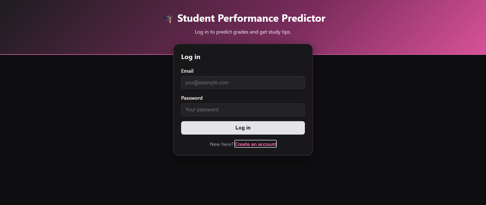
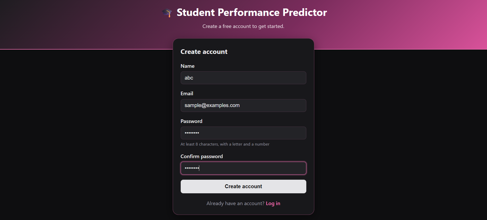
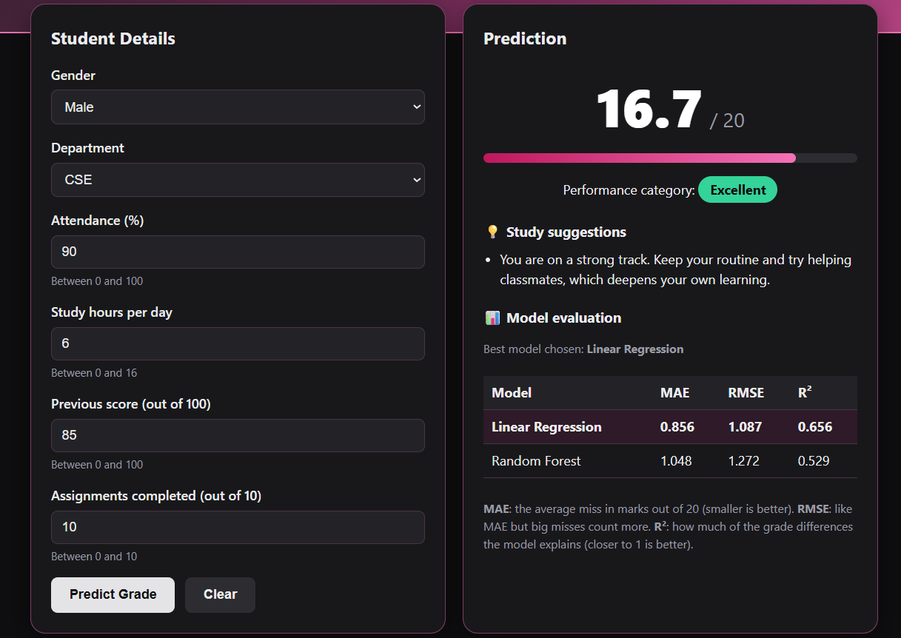
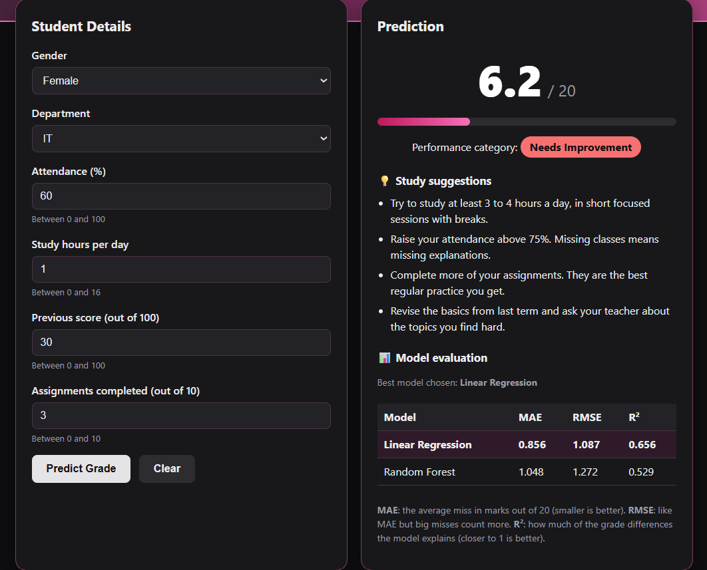
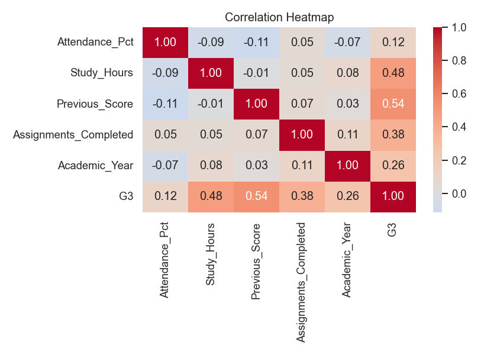
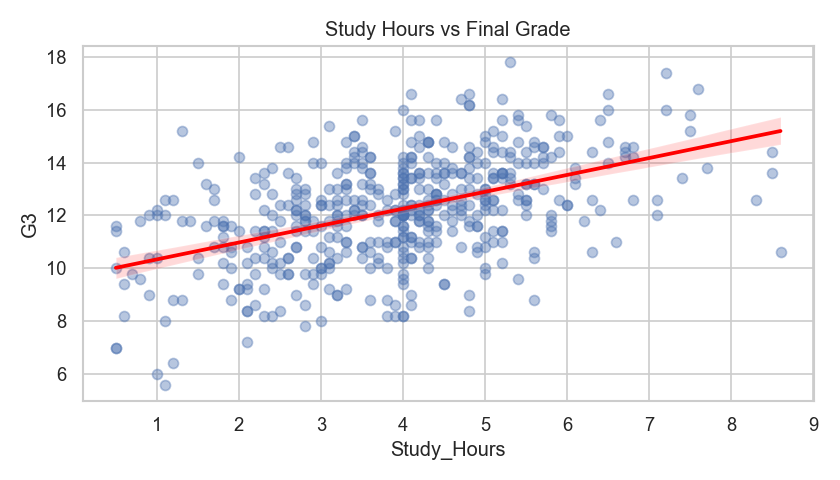

# 🎓 Student Performance Predictor

A web app that predicts a student's **final grade out of 20** from study habits and past performance, then shows a **performance category**, **personalised study suggestions** and the **model's evaluation scores**.

Built with **Python, Flask, scikit-learn, Pandas, Matplotlib, Seaborn, HTML, CSS and JavaScript**.

---

## Screenshots

### Log in and create an account
| Log in | Create account |
|---|---|
|  |  |

### Prediction result


### A student who needs support


---

## Features

- **Grade prediction out of 20** using a trained machine-learning model
- **Performance category**: Excellent, Good, Average or Needs Improvement
- **Study suggestions** tailored to the inputs (study hours, attendance, assignments, previous score)
- **Model evaluation** (MAE, RMSE, R²) shown next to every prediction
- **Account system**: sign up and log in; passwords are stored scrambled (hashed), never as typed; only logged-in users can use the predictor
- **Input validation** in the browser *and* on the server, with friendly error messages
- **Responsive dark theme** with a pink accent that works on desktop and mobile

---

## How it works (in plain words)

Think of the project as a small restaurant:

| Restaurant | In this project |
|---|---|
| Washing and sorting the ingredients | `eda.py` cleans the raw data |
| Tasting the ingredients | `visualize.py` draws charts |
| Two chefs competing, best recipe written down | `train_model.py` trains Linear Regression and Random Forest, keeps the winner |
| The waiter who carries orders to the kitchen | `app.py` (Flask) receives the form and asks the model |
| The reception desk and wristbands | `auth.py` and the login routes |
| The menu and order form | `templates/` and `static/` (HTML, CSS, JavaScript) |

---

## The data

The model learns from a student-performance dataset of **515 raw rows**. Cleaning:

- removed 15 duplicate rows (500 students remain)
- standardised spellings (for example `male`, `M` → `Male`; `Info Tech` → `IT`)
- converted text such as `72.1%` to numbers and treated `N/A` as missing
- marked impossible values (such as attendance above 100%) as missing
- filled missing values with the median (numbers) or most common value (text)
- converted the final score to a grade out of 20 (`G3 = Final_Score / 5`)
- left out columns that would give away the answer (subject marks, the pass/fail result) and ID labels

**Inputs used by the model:** gender, department, attendance (%), study hours per day, previous score, assignments completed.

### What the data showed

| Correlation heatmap | Study hours vs final grade |
|---|---|
|  |  |

Previous score, study hours and assignments completed move most strongly with the final grade. Attendance has only a weak link, and department and gender barely matter.

---

## Model results

Both models were trained on 400 students and tested on 100 students they had never seen.

| Model | MAE | RMSE | R² | 5-fold CV R² |
|---|---|---|---|---|
| **Linear Regression** (saved) | **0.856** | **1.087** | **0.656** | **0.662** |
| Random Forest | 1.048 | 1.272 | 0.529 | 0.605 |

- **MAE**: the typical miss is under 1 mark out of 20.
- **R²**: the model explains about two-thirds of the differences in grades.

The best model is saved with Joblib to `model/best_model.joblib`.

### Please note
This is an **estimate** based on past student data, not a guarantee. It should be used as a study guide, not to make decisions about a real student.

---

## Project structure

```
student-performance-app/
├── data/                  # raw and cleaned datasets
├── model/                 # saved model (best_model.joblib) and metrics.json
├── static/
│   ├── css/style.css      # styling
│   ├── js/script.js       # browser logic for the predictor
│   └── charts/            # charts made by visualize.py
├── templates/             # index.html, login.html, register.html
├── screenshots/           # images used in this README
├── app.py                 # Flask backend (routes, validation, predictions)
├── auth.py                # user database and password helpers
├── eda.py                 # data cleaning
├── visualize.py           # exploratory charts
├── train_model.py         # trains, compares and saves the model
├── test_app.py            # automated tests
└── requirements.txt       # pinned package versions
```

---

## Run it on your computer

You need **Python 3.10 or newer**.

**1. Download the project**
```bash
git clone https://github.com/PriyankaGaikar/student-performance-app.git
cd student-performance-app
```

**2. Create a virtual environment and install the packages**

Windows (PowerShell):
```bash
python -m venv venv
venv\Scripts\activate
pip install -r requirements.txt
```

Mac / Linux:
```bash
python3 -m venv venv
source venv/bin/activate
pip install -r requirements.txt
```

**3. Start the app**
```bash
python app.py
```

**4. Open it** at <http://127.0.0.1:5000/>, create an account, log in and try a prediction.

The first run creates two private files automatically: `users.db` (accounts) and `secret_key.txt` (used to sign logins). Both are listed in `.gitignore` and are never uploaded.

### Optional: rebuild the data and model

```bash
python eda.py            # clean the raw data
python visualize.py      # redraw the charts
python train_model.py    # retrain and save the best model
```

---

## Tech stack

Python · Flask · scikit-learn · Pandas · NumPy · Matplotlib · Seaborn · Joblib · SQLite · HTML · CSS · JavaScript
